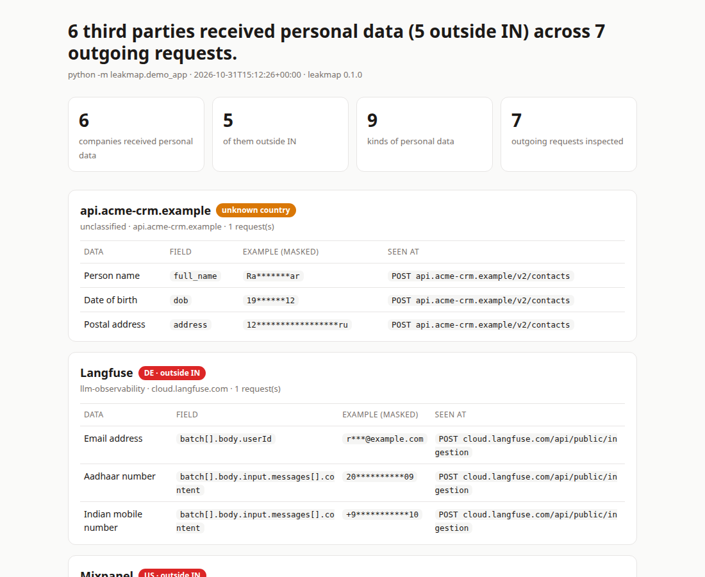

# leakmap

See what personal data your app sends to third parties. Fail CI when a new flow appears.

Run your tests through leakmap. It records every outgoing request, finds personal data in it (Aadhaar, PAN, UPI IDs, Indian mobile numbers, emails, cards and more), names the company and country receiving it, and keeps a reviewed baseline in your repo. A pull request that starts sending something new fails the check.



## Try it (10 seconds, offline)

```bash
uv tool install leakmap
leakmap demo --open
```

The demo runs a small fake support bot that calls OpenAI, Langfuse, Sentry, Mixpanel, Razorpay and an unknown CRM. Every request is answered locally, so nothing leaves your machine.

## Use it on your app

```bash
leakmap run -- pytest              # record what your tests send out
leakmap report --format html -o leakmap.html
leakmap baseline                   # accept current flows into leakmap.lock, then commit it
leakmap check                      # exit 1 if a run has flows not in leakmap.lock
```

In CI, one step does both:

```yaml
- run: uv tool install leakmap
- run: leakmap run --stub --check -- pytest
```

`--stub` answers every request locally, so CI never sends test data to real vendors. Leave it off to forward requests normally.

## What it finds

A value is reported on its own only when a checksum, registry or distinctive shape backs it. Values without one (a bank account, a CVV, a passport number) are reported only next to a label that says what they are: `passport no.`, `CVV:`, `"routing_number": ...`.

| Data | How |
|---|---|
| Aadhaar | 12 digits + Verhoeff checksum |
| PAN, GSTIN | Structure; GSTIN check character; lower-case or spaced PAN next to "PAN" |
| UPI ID | `name@handle` for 90+ bank/app handles; any handle next to "UPI" / "VPA" |
| Phone | Indian mobiles; other numbers written with `+` or separators and valid under the numbering plan ([phonenumbers](https://github.com/daviddrysdale/python-phonenumbers)) |
| Payment card, IBAN, US routing number, US SSN | Luhn + issuer ranges; IBAN mod-97 and country length; ABA checksum; SSA rules |
| Email, IFSC, SWIFT/BIC, MAC, public IPv4 / IPv6 | Patterns; BIC country code; global addresses only |
| Vehicle | Indian registration (state code), BH series; North American VIN check digit |
| Driving licence, passport, voter ID (EPIC), tax ID (EIN, ITIN, TAN), health record / ABHA, bank account, CVV, PIN | Shape plus a label next to it (Indian DL format and ABHA on their own) |
| Crypto wallet | Bitcoin base58check and bech32 checksums; Ethereum `0x` addresses next to a label |
| Date of birth, coordinates, postal code | Dates or numbers next to "DOB" / "lat" / "PIN code"; coordinates with N/S E/W |
| Name, address, gender, health | Field names, also inside text (`First Name: …`, markdown tables); street-address shape; optional model (below) |
| API keys and secrets | 30+ fixed-prefix formats (OpenAI, Anthropic, AWS, GitHub, GitLab, Slack, Google, Stripe, Razorpay, Hugging Face, Groq, SendGrid, Twilio, npm, PyPI, Shopify, Databricks, Telegram, Azure, Slack/Discord webhooks, ...), private keys, JWTs, database URLs with a password, `Bearer` tokens, values after `password:` / `api_key=` / `token is` |

**Names and addresses in free text** need a language model. `uv tool install 'leakmap[ner]'` and `leakmap run --ner` add [GLiNER's PII model](https://huggingface.co/urchade/gliner_multi_pii-v1) (Apache-2.0, runs on CPU, pinned to a commit). It adds torch to the install and 0.1–0.5 s per long text value, so it is off by default.

Base64 values are decoded and scanned (Mixpanel sends events as `data=<base64 JSON>`). It looks inside JSON, JSON encoded inside JSON (common in tracing SDKs), NDJSON / Sentry envelopes, form bodies, multipart, query strings, URL paths and **OpenTelemetry protobuf** (Langfuse, Logfire, Arize, Traceloop). Detectors live in [`leakmap/data/detectors.yaml`](leakmap/data/detectors.yaml); vendors in [`leakmap/data/vendors.yaml`](leakmap/data/vendors.yaml) (127 companies).

Precision comes first: a check that raises false alarms gets removed from CI. The test suite includes everyday payloads (UUIDs, trace IDs, timestamps, order IDs, tool schemas) that must produce no findings.

## Accuracy

Scored on four public PII datasets I did not write: [Nemotron-PII](https://huggingface.co/datasets/nvidia/Nemotron-PII), [Gretel finance](https://huggingface.co/datasets/gretelai/synthetic_pii_finance_multilingual), [Ylemis](https://huggingface.co/datasets/Pranshurs/ylemis-india-pii-benchmark) and [Maskara](https://huggingface.co/datasets/somukandula/maskara-indian-pii-200k), 133,194 test documents in all. The rules were frozen before any test set was scored, and the numbers below come from that one run, at the default floor. "Valid" means gold values that pass the category's checksum. Generators also write numbers no real system issues, and leakmap drops those on purpose.

| Data | Dataset | Precision | Recall |
|---|---|---|---|
| Email | Nemotron | 99.8% | 99.2% |
| Aadhaar, PAN, GSTIN, IFSC, UPI, Indian mobile, passport, vehicle | Ylemis | 100% | 100% |
| Aadhaar | Maskara | 100% | 86.1% of valid (7.5% of all) |
| Phone | Nemotron | 95.5% | 99.9% of valid (81.3% of all) |
| Card | Nemotron | 99.1% | 99.8% of valid (11.8% of all) |
| IBAN | Gretel finance | 97.5% | 95.6% of valid |
| US SSN | Nemotron | 88.1% | 99.0% |
| Date of birth | Nemotron | 98.8% | 98.8% |
| MAC address | Nemotron | 99.8% | 99.9% |
| Driving licence / passport | Maskara | 100% | 96.3% / 96.0% |
| Bank account | Nemotron | 97.1% | 81.2% |
| API keys and passwords | Nemotron / Maskara | 83.5% / 98.5% | 77.1% / 84.9% |
| Address | Nemotron | 98.7% | 68.7% |
| Name (rules only) | Nemotron | 98.0% | 29.5% |

None of the 1,956 negative documents in Ylemis and Maskara produced a finding.

Weak spots:

- **Names.** Without `--ner`, a name is found only after a label or in a name field. With `--ner`, name recall is 72–99%, but precision drops to 59–100% depending on the dataset ([details](benchmark/independent.md#optional-name-and-address-model---ner)).
- **Addresses** are only partly found.
- **Bare IPs.** At the default floor, a bare IP is hidden as low confidence.
- **Hindi and Bengali labels.** Voter IDs labelled in those scripts are missed.

Several of the "false alarms" are real data that the dataset left unlabelled, such as session cookies, diagnoses and ZIP codes. Rule bugs that the held-out run turned up were fixed afterwards, and those numbers are reported separately as tuned on test.

Full per-category tables with 95% intervals, every dataset, the label-quality checks and the error breakdown are in [`benchmark/independent.md`](benchmark/independent.md).

Older checks: the synthetic Indian API traffic set ([`benchmark/`](benchmark/README.md)) is one I wrote, so treat it as a regression suite. [Real traffic](benchmark/real-traffic.md) recorded in the pydantic-ai, crewAI, langchain and llm-anthropic test suites (5,109 requests) was checked by hand. In [live runs on real codebases](benchmark/real-codebases.md) with planted values, all 27 that left the machine were caught. That is a small sample.

## Tested against real SDKs

`tests/test_real_sdks.py` runs the official SDKs through the proxy with fake values and checks what is found:

| SDK | Version | What leakmap saw |
|---|---|---|
| openai | 3.42.0 | Aadhaar, email, phone in `messages[].content` |
| anthropic | 2.3.0 | Aadhaar, email, phone in `messages[].content` |
| langfuse | 5.1.0 | Aadhaar, email, phone in OTLP attribute `langfuse.observation.input` (captured automatically by `@observe`) |
| sentry-sdk | 2.73.0 | PAN in the exception message, IP in `user`, plus nearby **source code lines** |
| posthog | 7.81.1 | phone, UPI ID in event properties |
| mixpanel | 5.4.1 | name, PAN in event properties |

## Rules (`leakmap.yaml`, optional)

```yaml
home_country: IN          # flows outside this country are highlighted
min_confidence: medium    # low | medium | high
ignore_hosts: ["*.internal.example.com"]
deny:                     # always fail, even if baselined
  - data: aadhaar
    country_not: IN
    reason: Aadhaar must not leave India
```

## How it works

`leakmap run` starts [mitmproxy](https://mitmproxy.org) on 127.0.0.1 and runs your command with `HTTPS_PROXY` and a temporary CA set for Python, Node (`NODE_EXTRA_CA_CERTS`, `NODE_USE_ENV_PROXY`), curl and Go. Each request is inspected in memory; only the category, field path and a masked sample (`AB******4F`) are written. Bodies, headers and credentials are never stored, and the CA is deleted when the run ends.

## Limits

- It sees requests that reach the network. If your tests mock HTTP clients, those calls are invisible; run an integration suite or a staging smoke test instead.
- Browser-side trackers (pixels, analytics JS) are not covered yet; this is for backend and test traffic.
- In `--stub` mode every request gets `{}` back. SDKs that validate responses may log errors.
- Country is the vendor's headquarters. Where your data is processed depends on your plan and region; check the vendor's DPA.
- A clean report means leakmap saw nothing in this run, not that nothing is sent. It is evidence for a privacy review, not legal advice or a compliance certificate.

## License

Apache-2.0
